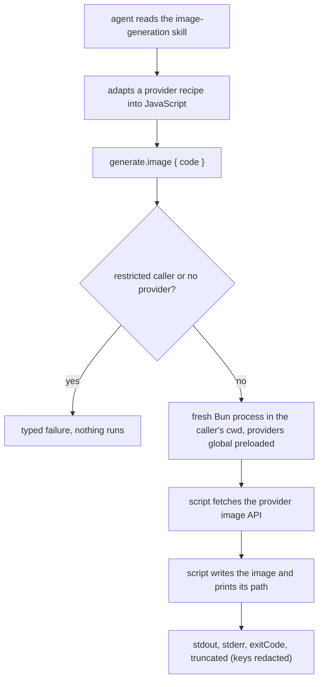

# `generate.image` Script Runner And The OpenAI-Compatible Provider

`generate.image` follows upstream: the caller sends JavaScript, Lilac runs it in
a fresh Bun process with the configured provider endpoints, and the script calls
the provider's image API directly and writes the image to a file. Model choice
lives in the built-in `image-generation` skill, not in code, so a new provider
model is usable as soon as the provider serves it.

The fork adds one thing: an OpenAI-compatible gateway (for example new-api) is
exposed to scripts as `providers.openaiCompatible`, with a recipe in the skill.

Earlier fork versions replaced this runner with a structured tool (prompt, Lilac
model alias, size, mask) and `tools.generate.image` routing. That tool and its
configuration are removed; see [Migrating from the structured tool](#migrating-from-the-structured-tool).

## How it works

| Module | Owns |
| --- | --- |
| `apps/core/src/tool-server/tools/image-script.ts` (upstream) | Input schema, provider discovery, process execution, output capture, and redaction |
| `apps/core/src/tool-server/tools/image-script-preload.ts` (upstream) | Installs the `providers` global before the script runs |
| `apps/core/src/tool-server/tools/image-script-openai-compatible.ts` (fork) | Builds the `openaiCompatible` provider from `OPENAI_COMPATIBLE_*` |
| `packages/utils/builtin-skills/image-generation/` | Default models per provider and one recipe file per provider; `references/openai-compatible.md` is fork-owned |



### Contract

- Input: `{ "code": "<JavaScript source>" }`. Any other field is rejected.
- The script runs with top-level await, standard imports, `fetch`, `FormData`,
  and `Bun.write`, in the caller's cwd with the container environment.
- Output: `stdout`, `stderr`, `exitCode`, and `truncated`. A nonzero `exitCode`
  is a script failure even though the call itself succeeded. Each stream is
  capped at 40 KiB.
- Execution stops after 10 minutes or on caller cancellation; the whole process
  group is killed.
- Configured API keys are redacted from both streams.
- Restricted callers are denied: the script runs as trusted container code.
- Nothing is retried, and no provider falls back to another.

### Providers

The `providers` global contains only configured providers. Each entry has
`baseURL` (trailing slashes removed) and an optional `apiKey`.

| Script key | Configured when | `baseURL` default |
| --- | --- | --- |
| `openai` | `OPENAI_API_KEY` or `OPENAI_BASE_URL` | `https://api.openai.com/v1` |
| `openrouter` | `OPENROUTER_API_KEY` or `OPENROUTER_BASE_URL` | `https://openrouter.ai/api/v1` |
| `xai` | `XAI_API_KEY` or `XAI_BASE_URL` | `https://api.x.ai/v1` |
| `openaiCompatible` (fork) | `OPENAI_COMPATIBLE_BASE_URL` | none; `OPENAI_COMPATIBLE_API_KEY` is optional |

When no provider is configured, `generate.image` is hidden from the tool catalog
and calls fail with `unavailable`. The catalog description lists the configured
provider keys, never their endpoints or keys.

## Configure the OpenAI-compatible provider

Set the endpoint in the environment of the core runtime or standalone tool
bridge, then restart it:

```dotenv
OPENAI_COMPATIBLE_BASE_URL=https://provider.example.com/v1
OPENAI_COMPATIBLE_API_KEY=replace-with-your-api-key
```

These are the same variables the `openai-compatible` chat provider and the
OpenAI `web.search` provider use, so setting them for either also exposes the
endpoint to image scripts. No `core-config.yaml` field is involved.

The base URL must include the API version prefix; recipes append
`/images/generations`, `/images/edits`, and `/models`. The API key is sent as an
`Authorization: Bearer` header. The endpoint is an operator-controlled trust
boundary: prompts, source images, and masks go to it.

## Models

The skill's catalog picks the first configured provider in the order `openai`,
`openrouter`, `xai`, `openaiCompatible`, unless the user names a provider or
model:

| Provider | Default model |
| --- | --- |
| `openai` | `gpt-image-2.5-sunburst`; `gpt-image-2.5-flare` for fast drafts |
| `openrouter` | `google/gemini-3.1-flash-image-preview` (Nano Banana 2) |
| `xai` | `grok-imagine-image-2.0` |
| `openaiCompatible` | Whatever the gateway serves; the recipe lists `GET /models` first |

Because scripts send native request fields, provider options such as GPT Image
2.5's `quality: "xhigh"` or `"max"` work without an SDK update. Upstream owns
the provider recipes; update the fork's `openai-compatible.md` recipe when the
gateway's behavior changes.

### Gateway notes

- An OpenAI GPT Image model behind the gateway takes the same sizes, quality
  values, and masks as the `openai` recipe.
- new-api maps a colon-form `size` such as `"16:9"` to Gemini's aspect ratio for
  Gemini image models. Other gateways may reject a non-`WxH` size.
- Gateways answer with `b64_json` or a short-lived `url`; the recipe saves both.
- Edit uploads carry explicit multipart filenames. Bun sends unnamed blobs with
  `filename=""`, which OpenAI-style `/images/edits` endpoints reject.

## Use it

List the configured providers:

```bash
tools --help generate.image
```

Adapt a recipe into a local file and submit it:

```bash
bun -e 'console.log(JSON.stringify({code: await Bun.file("image-request.js").text()}))' | tools generate.image --stdin
```

A minimal script for the compatible endpoint:

```js
const provider = providers.openaiCompatible;
if (!provider) throw new Error("The OpenAI-compatible endpoint is not configured");
const response = await fetch(`${provider.baseURL}/images/generations`, {
  method: "POST",
  headers: {
    "Content-Type": "application/json",
    ...(provider.apiKey ? { Authorization: `Bearer ${provider.apiKey}` } : {}),
  },
  body: JSON.stringify({ model: "gpt-image-2.5-flare", prompt: "A rainy Taipei street at night" }),
});
if (!response.ok) throw new Error(`Endpoint ${response.status}: ${await response.text()}`);
const { data } = await response.json();
const bytes = await Bun.write("taipei.png", Buffer.from(data[0].b64_json, "base64"));
console.log(JSON.stringify({ path: "taipei.png", bytes }));
```

## Migrating from the structured tool

| Before | Now |
| --- | --- |
| `generate.image` with `prompt`, `model` alias, `size`/`aspectRatio`, `inputImages`, `maskImage`, `outputDir` | `generate.image` with `code`; those fields are rejected |
| Lilac aliases such as `gpt-image-2` or `nanobanana-2` | Provider model IDs written in the script, chosen from the skill or the user's request |
| `tools.generate.image.provider: openai-compatible` | Set `OPENAI_COMPATIBLE_BASE_URL`; scripts choose `providers.openaiCompatible` |
| `tools.generate.image.routes.<alias>: <provider>/<model id>` | The script names the provider and model ID directly |
| `tools.generate.image.models` allowlist | None; configure only the providers that should be reachable |
| Validation of sizes and ratios before the request | The provider validates the request and returns its error |
| Restricted callers could generate images | Restricted callers are denied |
| Result with `path`, `mimeType`, `model`, `providerMetadata` | The script prints what it needs, usually path, byte count, MIME type, and usage |

A leftover `tools.generate` block in `core-config.yaml` does not fail parsing:
Core logs `unknown core-config key ignored` for it and ignores it. Remove it.

## Troubleshooting

### `generate.image` is missing from the tool list

No provider is configured in the process that serves tools. Set at least one
provider's variables and restart the core runtime or tool bridge.

### `providers.openaiCompatible` is undefined

`OPENAI_COMPATIBLE_BASE_URL` is unset or empty in that process. An API key alone
does not configure the provider because it has no default endpoint.

### The gateway returns 404

Check that the base URL includes the version prefix, usually `/v1`.

### The gateway rejects the model

Run the recipe's model listing, then use an ID the gateway serves. A listed ID
can still be a text-only model.

### The call returns `denied`

The caller runs in restricted safety mode. Image scripts require trusted
execution.
